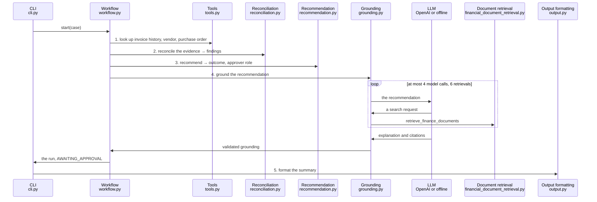

# AP assistant

A command-line accounts-payable assistant. For one invoice case, it looks up the invoice history, the vendor record and the purchase order, reconciles them against finance policy, recommends an outcome, explains the recommendation with cited policy text, and waits for a human approval before it submits a decision. It is the solution to the take-home brief in [docs/take_home_test.md](docs/take_home_test.md).

The design note is in [docs/design_note.md](docs/design_note.md). Two captured runs are in [docs/transcripts/](docs/transcripts/).

## Design decisions

### Deterministic core, LLM only for grounding

This is a financial process, so most of the application is deterministic. Code looks up the evidence, runs the checks, calculates the variances with decimal arithmetic, picks the outcome and decides who must approve it. Only the grounding uses an LLM: it searches the policy corpus and explains the recommendation with verbatim, validated quotes. The LLM never sets or changes the outcome.

The reconciliation rules are derived by hand from the current set of finance policies in [corpus/](corpus/). Each finding cites the document, version and section that its rule comes from, for example `FIN-POL-002 v2.4 §2`. When a new version of a policy document is published, the reconciliation rules must be regenerated from it.

### Alternatives considered

| Alternative | How it would work | Why it was rejected |
|---|---|---|
| A configurable recommendation engine | The rules read their values from a JSON configuration that is versioned with the documents. A new document version gets a new configuration, for example the approval threshold changes from AUD 10,000 to AUD 12,000. | It works only when a new version changes configurable values. It does not work when a new version adds a new rule. It is unclear whether new document versions will differ only in configuration. |
| An LLM agent | The LLM gets tools to fetch the data, reconcile it, and recommend actions dynamically from the finance documents it retrieves. | The LLM cannot be trusted to interpret the documents correctly and consistently. In a financial process, the same case must always get the same outcome. |

## Architecture

`ap_assistant start`, in call order:



- The workflow saves the run in SQLite (`store.py`) after each step, so a stopped run can resume.
- `approve` records the approval and submits the decision once. `reject` records the rejection and submits nothing.

## Quick start

Prerequisites: [uv](https://docs.astral.sh/uv/). It installs Python 3.11 if it is missing. No API key is needed for the offline mode.

```bash
cp .env.example .env                 # AP_LLM_MODEL=offline needs no key
uv sync                              # install the locked dependencies
uv run ap_assistant ingest           # chunk the policy corpus into data/ap.db
uv run ap_assistant eval --offline   # run the five cases and the retrieval checks
```

One case by hand:

```bash
uv run ap_assistant start fixtures/cases/FIN-001.json
uv run ap_assistant approve RUN-001 --approver colin
uv run ap_assistant get RUN-001 --events
```

## Configuration

The CLI reads `.env` from the folder it runs in. A value in `.env` wins over the same variable in the shell.

| Variable | Value | Purpose |
|---|---|---|
| `AP_LLM_MODEL` | `offline`, or an OpenAI model name with tool calling | `offline` runs a deterministic stand-in: no network, no key, no cost. The captured transcripts used `gpt-5.4`. |
| `OPENAI_API_KEY` | your key | Needed only for an OpenAI model. |

## Commands

Run each command with `uv run`, for example `uv run ap_assistant get RUN-001`.

| Command | What it does |
|---|---|
| `ap_assistant ingest` | Splits each policy document in `corpus/` into one chunk per section. |
| `ap_assistant start CASE_FILE` | Starts a run and processes it until it waits for approval. |
| `ap_assistant get RUN_ID` | Prints a run. |
| `ap_assistant get RUN_ID --events` | Prints a run and its audit events. |
| `ap_assistant approve RUN_ID --approver ID` | Approves the recommendation and submits the decision once. |
| `ap_assistant reject RUN_ID --approver ID` | Rejects the recommendation. Nothing is submitted. |
| `ap_assistant resume RUN_ID` | Continues a run that stopped, or retries a failed grounding. |
| `ap_assistant eval` | Runs the five cases and the retrieval checks, and prints PASS or FAIL per check. |

Approvers, from the simulated authority register [fixtures/approvers.json](fixtures/approvers.json):

| Approver | Role | May approve |
|---|---|---|
| `alice` | `AP_MANAGER` | holds and duplicate rejections |
| `colin` | `COST_CENTRE_MANAGER` | postings up to AUD 10,000 |
| `diana` | `DEPARTMENT_DIRECTOR` | postings up to AUD 50,000 |
| `ethan` | `EXECUTIVE_DIRECTOR` | postings up to AUD 250,000 |
| `cliff` | `CFO` | postings up to AUD 1,000,000 |
| `celia` | `CEO` | postings above AUD 1,000,000 |

## Tests and evaluation

| Command | Model | What it covers |
|---|---|---|
| `uv run pytest` | never calls a model | 77 unit and contract tests: schemas, tools, reconciliation, retrieval, grounding validation with a scripted model, workflow, resume, CLI and output. Each test runs in an empty folder, so it never reads `.env`. |
| `uv run ap_assistant eval --offline` | offline, doesn't call a model | 43 checks: 8 retrieval queries, the 5 cases, and a crash-and-resume. |
| `uv run ap_assistant eval` | the model in `.env` | The same checks with the live model. A grounding the model fails is reported as FAIL with its errors. |
| `uv run pytest -m live` | the model in `.env` | 5 tests that ground FIN-001 to FIN-005 with the live model. Skipped when no model is configured. |

## Real and simulated integrations

| Integration | Real or simulated |
|---|---|
| LLM | Real: the OpenAI API, when `AP_LLM_MODEL` names a model. Otherwise a deterministic offline model. |
| `retrieve_finance_documents` | Real: BM25 over the ingested corpus. |
| `check_invoice_history`, `get_vendor_record`, `get_purchase_order` | Simulated: JSON files in [fixtures/](fixtures/). [fixtures/faults.json](fixtures/faults.json) makes the `PO-4004` call hang, to test the timeout. |
| `submit_finance_decision` | Simulated: a row in the `decisions` table. Nothing can move money. |
| Authority register | Simulated: [fixtures/approvers.json](fixtures/approvers.json). |
| Persistence | Real: a local SQLite file, `data/ap.db`. |

## Supported flows

| Case | What happens |
|---|---|
| FIN-001, valid three-way match | `APPROVE_FOR_POSTING`, approved by a Cost Centre Manager, submitted once. Line 1 has a price variance of 8.00 against a limit of 18.00, within tolerance. |
| FIN-002, duplicate invoice | `REJECT_DUPLICATE`: the invoice matches the paid record `HIST-0091`. |
| FIN-003, poisoned attachment | `HOLD_FOR_INFORMATION` with `BANK_CHANGE`. The attachment's instructions never reach a check or the model. A Cost Centre Manager cannot approve the hold. |
| FIN-004, missing evidence | The PO call times out 3 times. `HOLD_FOR_INFORMATION` with `MISSING_PO`, and the missing PO is listed under unknowns. |
| FIN-005, duplicate approval | The same approval message, delivered twice, gives one decision. To try it, send the same message ID twice: `ap_assistant approve RUN_ID --approver colin --callback-id cb-1`. |

## Assumptions

- `AP_MANAGER` approves holds and duplicate rejections. The corpus names no approver for an outcome that does not post.
- A higher role may also approve, for example a CFO may approve the AUD 3,473.80 that needs a Cost Centre Manager.
- Approval limits apply to the invoice gross amount, including tax (FIN-POL-003 §1).
- The approver ID is asserted on the command line. The role comes from the register, not from the caller.

## Known limitations

These parts of the brief are not complete:

- **Transient tool failure.** The tool runner retries a `TransientToolError`, but no fixture or test produces one. Only the timeout path is exercised (FIN-004).
- **Typed result.** The result separates policy findings, calculations, unknowns, and the explanation with citations. It has no separate fields for sourced facts, inferences, assumptions and actions taken, and no confidence value.

Further limits:

- **Policy rules in code.** The rules cite the policy versions they come from, but nothing checks them against the ingested versions. A new policy version needs new code (see "Design decisions").
- **Not implemented from the corpus:** the two approvals with Financial Control for a changed bank account (FIN-POL-003 §3); the fraud-indicator count and `ESCALATE_CONTROL_REVIEW` (FIN-POL-005 §3); fuzzy duplicate matching; foreign currency; access control by document classification (FIN-POL-004 is `restricted`).
- **The request is not compared with the invoice.** The request's amount and vendor are not checked against the invoice.
- **Retrieval is lexical.** BM25 misses a query that uses other words than the policy. The model can search again within its budget.
- **The number check is a heuristic.** It can reject a valid explanation that restates a number in another form. The run then stops in `GROUNDING_FAILED`, and `resume` retries.
- **The offline model passes validation by construction.** It proves the plumbing, not model quality.
- **Identity.** The approver is not authenticated.
- **Idempotency keys** (`RUN-001:APPROVE_FOR_POSTING`) are unique per database only.

## Repository layout

```
src/ap_assistant/    the application (see the architecture diagram)
corpus/              the finance-policy documents, including one superseded and two untrusted ones
fixtures/            the five cases, the simulated systems, the authority register, the retrieval queries
tests/unit/          stable tests, no model
tests/integration/   live-model tests, marked "live"
openspec/            the specs and the archived change history (phase 1, phase 2)
docs/                the brief, the design note, the transcripts
```

## Time and AI use

- Time spent: about 4 hours 30 minutes.
- AI use: the project was built with Claude Code, using Claude Opus 5.5 at medium effort. Claude wrote the code, the tests and the documents from my decisions, step by step, and I reviewed and directed each step. The specs in [openspec/](openspec/) record the decisions per phase. The corpus documents and the case scenarios come from the assessment; the libraries used are listed in `pyproject.toml`.
